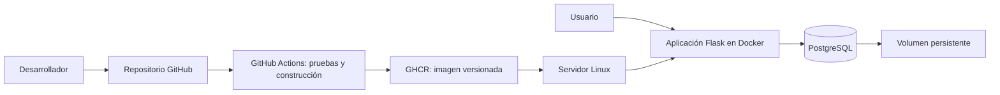

# PF-SIIEC: Sistema de inventario con integración y entrega continua

**Materia:** Infraestructura del Desarrollo Continuo  
**Repositorio:** [PachVsus/PF-SIIEC](https://github.com/PachVsus/PF-SIIEC)  
**Estado:** Propuesta y planificación; implementación pendiente.

## 1. Descripción

El proyecto consiste en desarrollar una aplicación web de inventario y una infraestructura reproducible para validar, construir y desplegar sus cambios automáticamente. La aplicación servirá como caso práctico para demostrar integración y entrega continua, contenedores, persistencia de datos y verificación del servicio.

## 2. Planteamiento del problema

Los despliegues manuales pueden introducir errores de configuración, publicar cambios defectuosos y dificultar la reproducción de un entorno. Además, una actualización mal preparada puede interrumpir el servicio o comprometer la persistencia de los datos. Se propone un flujo automatizado que permita detectar errores antes de integrar cambios y verificar el funcionamiento después de desplegarlos.

## 3. Objetivos

### Objetivo general

Implementar una infraestructura reproducible que permita validar y desplegar cambios de un sistema de inventario mediante un pipeline de integración y entrega continua.

### Objetivos específicos

- Desarrollar las funciones esenciales de un inventario.
- Integrar PostgreSQL para almacenar productos y movimientos.
- Automatizar pruebas de las reglas de negocio.
- Empaquetar la aplicación mediante Docker y ejecutar sus servicios con Docker Compose.
- Ejecutar verificaciones en cada pull request mediante GitHub Actions.
- Publicar imágenes versionadas y automatizar su despliegue en Linux.
- Verificar la salud del servicio y la persistencia de los datos entre versiones.
- Documentar la instalación, configuración, despliegue y recuperación.

## 4. Alcance funcional

| Función | Resultado esperado |
|---|---|
| Gestión de productos | Registrar, consultar, editar y desactivar productos con código único. |
| Entradas | Registrar cantidades positivas y aumentar las existencias. |
| Salidas | Registrar cantidades positivas sin superar las existencias disponibles. |
| Consulta | Mostrar las existencias y el historial de movimientos. |
| Validaciones | Rechazar cantidades inválidas y conservar la consistencia del inventario. |

La interfaz será sencilla. El alcance inicial no incluye facturación, compras, múltiples almacenes ni administración avanzada de usuarios.

## 5. Tecnologías propuestas

| Componente | Tecnología | Propósito |
|---|---|---|
| Aplicación | Python y Flask | Lógica de negocio y páginas web. |
| Interfaz | HTML y CSS con plantillas | Operación y consulta del inventario. |
| Base de datos | PostgreSQL | Persistencia de productos y movimientos. |
| Pruebas | pytest | Validar reglas y operaciones principales. |
| Versionamiento | Git y GitHub | Ramas, pull requests y revisión de cambios. |
| Automatización | GitHub Actions | Pruebas, construcción y despliegue. |
| Contenedores | Docker y Docker Compose | Entorno reproducible de aplicación y base de datos. |
| Registro de imágenes | GitHub Container Registry (GHCR) | Almacenar imágenes identificadas por commit. |
| Despliegue | Servidor o máquina virtual Linux | Ejecutar la aplicación. |

Estas herramientas son parte de la propuesta; el servidor, los recursos y las versiones se definirán durante la primera fase.

## 6. Arquitectura propuesta

La configuración necesaria se documentará en un archivo de ejemplo sin credenciales. Los secretos del pipeline se almacenarán en GitHub Actions y los del servidor fuera del repositorio. La base de datos conservará su información en un volumen persistente.

## 7. Flujo de integración y entrega continua

1. Crear una rama para una tarea.
2. Implementar el cambio y abrir un pull request hacia `main`.
3. Ejecutar las pruebas y construir la imagen Docker.
4. Revisar el cambio y permitir su integración únicamente cuando pasen los controles requeridos; configurar protección de `main` para hacer cumplir esta regla.
5. Al integrar el cambio, publicar una imagen etiquetada con el identificador del commit.
6. Desplegar esa imagen mediante el pipeline en el servidor Linux.
7. Comprobar el endpoint de salud y realizar una verificación funcional básica.
8. Si falla el despliegue, identificar la causa y recuperar la imagen anterior mediante el procedimiento documentado.

El despliegue automático se realizará solo en el ambiente definido para el proyecto. Los pull requests ejecutarán validaciones sin acceder a credenciales de despliegue. Recuperar una imagen anterior no revierte automáticamente cambios de esquema o datos; estos deberán tratarse según el procedimiento de migración y respaldo.

## 8. Entregables

- Presentación del proyecto en PDF, proporcionada por el estudiante.
- Presentación del proyecto en Markdown para la Wiki de GitHub.
- Plan del proyecto en GitHub Projects, con tareas, estados y criterios de aceptación.
- Código de la aplicación y pruebas automatizadas.
- Dockerfile, configuración de Docker Compose y workflows de GitHub Actions.
- Diagrama de arquitectura y documentación operativa.
- Evidencias de una validación fallida, un despliegue exitoso y persistencia de datos.

## 9. Plan de trabajo

Se propone una duración de cuatro semanas a partir del inicio acordado. Las fechas y los responsables se definirán con el equipo.

| Semana | Actividades | Resultado verificable |
|---|---|---|
| 1 | Requisitos, modelo de datos, repositorio y gestión de productos. | Catálogo funcional y decisiones documentadas. |
| 2 | Movimientos, pruebas y contenedores. | Inventario validado y entorno local reproducible. |
| 3 | Integración continua, publicación de imágenes y despliegue. | Cambio integrado disponible en el servidor. |
| 4 | Salud, persistencia, recuperación, documentación y demostración. | Evidencias completas y entrega final. |

## 10. Criterios de éxito

- Registrar un producto y consultar sus existencias.
- Registrar una entrada y una salida válidas.
- Rechazar una salida superior al stock y cantidades no positivas.
- Detectar un cambio defectuoso mediante pruebas y bloquear su integración con controles requeridos.
- Construir y publicar una imagen identificable por versión.
- Desplegar un cambio aprobado y verificar que el servicio responde.
- Conservar los productos y movimientos al actualizar la aplicación.
- Reproducir el entorno siguiendo el manual.
- Ejecutar y documentar la recuperación de una versión anterior compatible.

## 11. Demostración final

1. Registrar un producto, una entrada y una salida; mostrar las existencias.
2. Abrir un pull request con un error controlado que una prueba detecte.
3. Mostrar la ejecución fallida y la restricción de integración.
4. Corregir el error y mostrar las verificaciones exitosas.
5. Integrar el cambio y mostrar la publicación y el despliegue.
6. Comprobar la versión desplegada, la salud del servicio y la conservación de los datos.
7. Mostrar el procedimiento de recuperación y las evidencias guardadas.

## 12. Riesgos y medidas

| Riesgo | Medida prevista |
|---|---|
| Servidor no disponible | Definir el ambiente desde la primera semana; usar una VM Linux si procede. |
| Pérdida de datos durante una actualización | Volumen persistente, prueba de actualización y respaldo antes de cambios de esquema. |
| Exposición de credenciales | Secretos fuera del repositorio y permisos limitados para el pipeline. |
| Alcance excesivo | Priorizar catálogo, movimientos y automatización; dejar mejoras para después. |
| Pipeline aprobado sin comprobar la aplicación | Combinar pruebas de negocio con verificación de salud y prueba funcional. |

## 13. Mejoras opcionales

- Ambiente de pruebas separado.
- Aprobación manual antes del despliegue a producción.
- Rollback automático para versiones compatibles.
- Respaldos programados y restauración verificada.
- Métricas y alertas básicas.

## 14. Organización del tablero

El tablero agrupará las tareas por estado: **Pendiente**, **En progreso**, **En revisión** y **Terminado**. Cada tarea incluirá semana sugerida, prioridad, dependencias y criterios de aceptación. Una tarea se considerará terminada cuando sus criterios estén verificados y la evidencia o el cambio correspondiente estén enlazados.